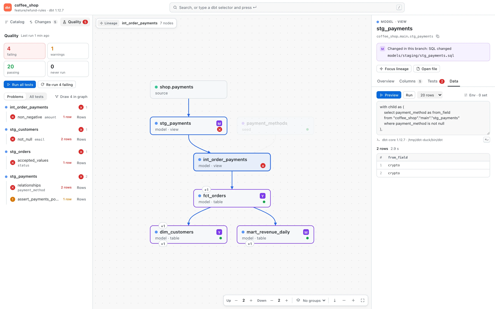

# dbt for Orca



A data catalog and lineage viewer for the dbt project in your Orca workspace. It works with dbt
v1 (dbt-core) and v2 (dbt Fusion), and with any warehouse your dbt profile connects to:
Snowflake, ClickHouse, Postgres, DuckDB and the rest.

One page, **dbt**. A search box on top, a side pane (**Catalog**, **Changes** or **Quality**),
the lineage graph in the middle and the node in hand on the right. They move together:

- **Search box**: type to search names, column names and descriptions; press ↵ to draw it as a
  dbt selector (`+orders+ tag:finance,config.materialized:table --exclude path:models/legacy`),
  or pick one from your `selectors.yml`. `/` or ⌘K jumps to it, Esc clears it.
- **Lineage graph**: the focused node's upstream and downstream, horizontal or vertical, with
  steppers for each depth. A chip in its corner says what it draws (a node's lineage, a selector,
  or the branch's changes) and clears a selector. Click a node to see it, double-click to centre
  the lineage on it, use `+n` to reveal hidden neighbours, drag to pan, scroll to zoom. Zoomed
  out, nodes become dots in their type's colour (ringed when changed or failing) so a big graph
  reads as a map; zoom in for the cards. **Group** draws the nodes in lanes by folder, tag,
  schema, owner, package or any meta key (none by default); unconnected pieces tile into a grid.
- **Catalog**: every model, source, seed, snapshot and exposure, A–Z or grouped by folder, tag,
  schema, resource type, package, owner or a meta key. Picking a node draws its lineage.
- **Changes**: what your branch changed since its base (committed, uncommitted and untracked),
  drawn with everything downstream of it, so a pull request's impact is one click away. Changed
  nodes are tagged in every graph: **A** new file, **M** SQL changed, **Y** YAML changed, **ƒ** a
  macro it uses changed. The pane shows the exposures (dashboards) affected and a
  `dbt build --select …` that builds and tests exactly the changes and what they feed.
- **Quality**: the latest result of every data and unit test (from `target/run_results.json`,
  so runs from a terminal count), problems first. Run them all, re-run the failing ones, query
  the rows a test found, or draw the nodes with problems. Failing nodes are flagged everywhere.
- **Details**: the node's type, relation and actions, then **Overview** (description in
  Markdown, tags, owner, properties, meta, upstream and downstream), **Columns** with their
  types and tests, **Tests** with their latest results, and **Data**: preview rows or run SQL
  (`{{ ref() }}` works) on the warehouse. The environment button shows and edits the variables
  queries run with (see below).

Colour is kept for meaning: blue for the node in hand and its lineage, violet for what the
branch changed, green, amber and red for test results, and a small dot in each resource type's
hue. In a narrow sidebar the graph sits above a sheet with one pane at a time (Details among
them) that you resize by dragging its tab bar; widen the panel past 900 px and they sit side by
side. The page follows Orca's light or dark theme and the workspace you are in.

## Install

You need Orca 1.4.248 or newer. Nothing else: the plugin has no build step and no dependencies
to install.

In Orca's plugin directory: [dbt for Orca](https://orca.dev/plugins/mz-jy.dbt?catalog=community).
Or from a terminal (it installs as `mz-jy.dbt`):

```sh
orca plugin install mz-jy/orca-dbt

# or from a local clone
git clone https://github.com/mz-jy/orca-dbt.git
orca plugin install ./orca-dbt
```

Orca lists the access the plugin asks for and prints the same command with `--approve <code>`;
run that to install it. In Orca, open the **dbt** panel from the right sidebar.

What it asks for, and why:

| Access            | Used for                                                                 |
| ----------------- | ------------------------------------------------------------------------ |
| Runs a worker     | reading `target/manifest.json`, running your project's dbt for queries   |
| `workspace:read`  | finding the focused workspace and its folder                             |
| `workspace:write` | opening a model's file in an editor tab                                  |
| `settings:own`    | the plugin's settings (project folder, dbt command, base branch, env file) |

## How it finds your project

- **Project**: the shallowest `dbt_project.yml` within three folders of the workspace root, or
  the folder in the **dbt project folder** setting. When none is found, the panel asks for the
  folder and saves it to that setting.
- **Manifest**: `<target-path>/manifest.json` (and `catalog.json`, for warehouse column types,
  when `dbt docs generate` has written it). No manifest yet? The panel offers **Run dbt parse**.
- **Queries** run `dbt show` with your project's own dbt, so they use your profile, adapter and
  credentials. The plugin
  - uses the nearest `.venv/bin/dbt` (project folder up to the workspace root), else `dbt` on
    `PATH`, `~/.local/bin`, `/opt/homebrew/bin` or `/usr/local/bin`; set **dbt command** (such as
    `uv run dbt` or `dbtf`) to choose;
  - loads every `.env` from the workspace root down to the project, as `just` with
    `dotenv-load` does, so `env_var()` in `profiles.yml` resolves; set **Env file** to read one
    file instead (`.env.local`, `secrets/prod.env`, …);
  - runs in the project folder, where dbt looks for `profiles.yml` before `~/.dbt`;
  - skips writing `target/` artifacts and the adapter's schema cache for queries
    (`DBT_WRITE_JSON=false`, `DBT_POPULATE_CACHE=false`): on a large project they cost more than
    the query itself. Tests and parse still write `manifest.json` and `run_results.json`;
  - with **Use dbt-core's v2 parser** on, sets `DBT_ENGINE_USE_V2_PARSER=true` (dbt-core 1.12+,
    which then parses with the Rust `dbt-core-experimental-parser`). It reparses
    the whole project every run and deletes `target/partial_parse.msgpack`, so it pays off when
    dbt-core's own parser would reparse in full anyway. When it fails on the project, the run is
    repeated with dbt-core's own parser, which that project keeps until Orca restarts.

  Snowflake with `authenticator: externalbrowser` opens your browser to sign in the first time.
  dbt-core reparses the whole project (a minute or more on a large one) whenever the profile's
  resolved connection changes, such as an env variable that picks the database, or when another
  dbt run used a different environment.
- **Environment** (in Data, and as **Set X…** when dbt reports a missing variable) lists the
  variables the profile and `dbt_project.yml` read with `env_var()`, each **set**, **default** or
  **missing**; the variables in the env files, masked until shown; and a form to add, edit or
  delete them. Changes are written to the env file itself (the deepest `.env`, or the chosen
  file), so `just`, direnv and your terminal see the same values. Pick another file there too.
- **Changes** compare the branch with its merge base on `origin`'s default branch (else
  `origin/main`, `origin/master`, `main`, `master`); set **Base branch for Changes** when your
  pull requests merge elsewhere. A `.sql`/`.py`/`.csv` maps to its model, seed or snapshot, a
  `.yml` to every node it documents or configures (including sources and exposures), and a
  macro to every model that calls it, directly or through other macros. Files no node comes
  from (`dbt_project.yml`, singular tests, …) are listed apart. When a changed file is newer
  than the manifest, the panel offers **Run dbt parse** so new models appear.

## dbt v1 and v2

Both are tested against manifests and `dbt show` output from dbt-core 1.12 and dbt Fusion 2.0
(`fixtures/versions`). What differs, and how the plugin handles it:

- YAML selectors: v1 stores the raw YAML under `definition`; v2 stores it flattened and
  normalized. Both are read.
- v2 writes every `dbt show --inline` query into the manifest as a model named `inline`; the
  catalog leaves those out.
- v2 writes warehouse column types into the manifest itself; v1 needs `catalog.json`.
- v2 can exit with an error from `dbt parse` and still write the manifest; the panel reloads
  either way and shows the error.

Not supported: workspaces on SSH or other Orca hosts (the plugin reads files on this
computer), and selector methods that need run artifacts (`state:`, `result:`,
`source_status:`) or select tests (`test_name:`, `test_type:`).

## Try it on the demo project

`demo/` is a small dbt project on DuckDB (a coffee shop: sources, staging, marts, an exposure,
data and unit tests, a few of them failing on purpose). Build it with dbt-core (dbt Fusion's
preview builds it too, but errors on its unit test and skips what depends on it):

```sh
uv venv && uv pip install dbt-core dbt-duckdb
cd demo && ../.venv/bin/dbt build                # then open the folder in Orca
```

Open `demo` as a workspace (or set **dbt project folder** to `demo`) and pick **Quality**.

## Develop

```sh
npm install                # TypeScript and Node typings, for type-checking only
npm run typecheck
orca plugin test .         # src/*.test.ts
orca plugin dev watch .    # loads this folder into Orca, streams logs, reloads on save
```

| File                         | What it is                                                         |
| ---------------------------- | ------------------------------------------------------------------ |
| `src/worker.ts`              | the worker: finds the project, caches the graph, runs dbt jobs     |
| `src/graph.ts`               | manifest and catalog.json into a graph and catalog (pure)          |
| `src/selector.ts`            | dbt's selector syntax and YAML selectors (pure)                    |
| `src/runner.ts`              | finding and running the project's dbt, reading its JSON logs       |
| `src/git.ts`                 | the branch's changed files since its merge base                    |
| `src/changes.ts`             | changed files onto nodes, what they reach, the build command (pure) |
| `src/protocol.ts`            | the requests and events between the page and the worker            |
| `ui/index.html`, `ui/app.ts` | the page: layout, state, and what each click does                  |
| `ui/graph-view.ts`           | the lineage graph: dagre's layout drawn as SVG, pan, zoom          |
| `ui/catalog-view.ts`         | the catalog tree and the search and selector result lists          |
| `ui/changes-view.ts`         | the branch's changes, what they reach, and the build command       |
| `ui/quality-view.ts`         | test results: counts, problems by node, runs                       |
| `ui/model-view.ts`           | the details pane: a node's docs, columns, tests and data            |
| `ui/env-view.ts`             | the Environment dialog                                              |
| `ui/dom.ts`, `ui/icons.ts`   | shared elements (buttons, marks, empty states) and inline icons     |
| `ui/page.css`                | the stylesheet: Orca's theme variables, one hue per meaning         |
| `vendor/`                    | `@dagrejs/dagre` 3.1.3 and `marked` 18.3 (MIT), vendored: plugin frames have no network |
